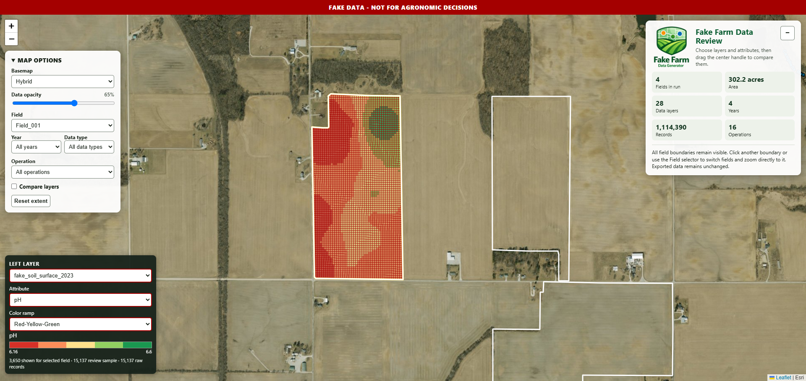
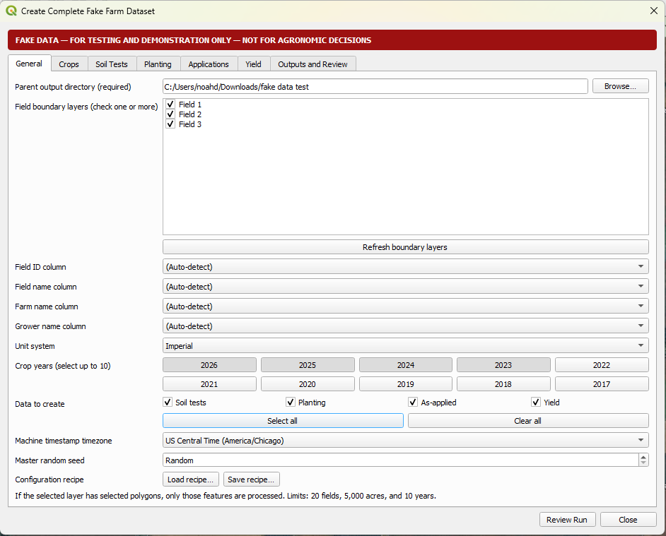
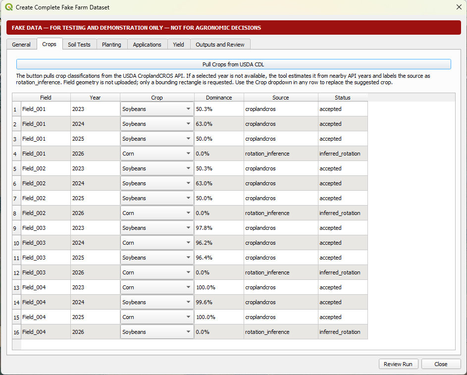
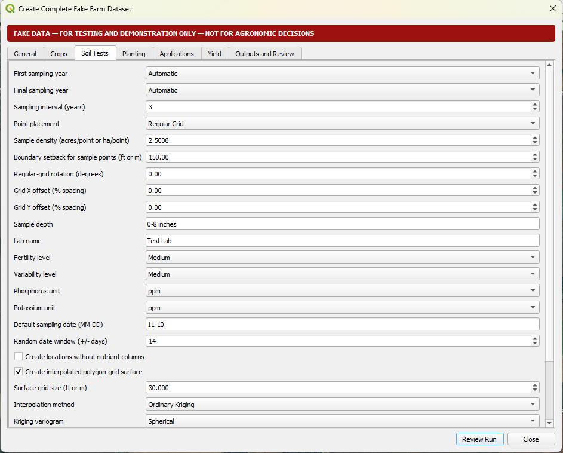
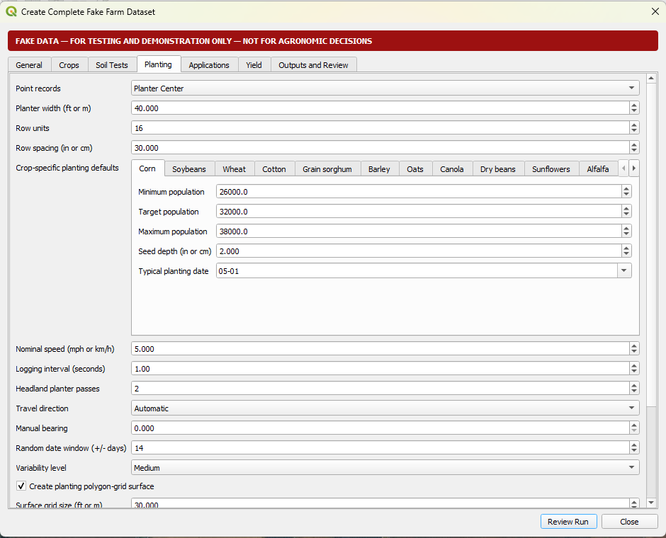
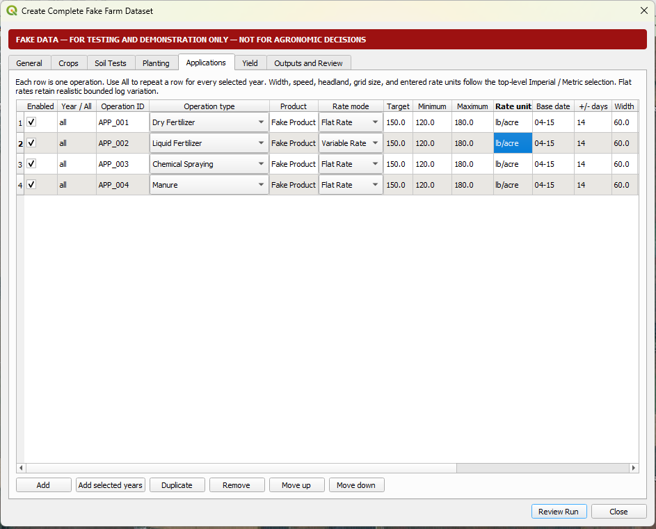
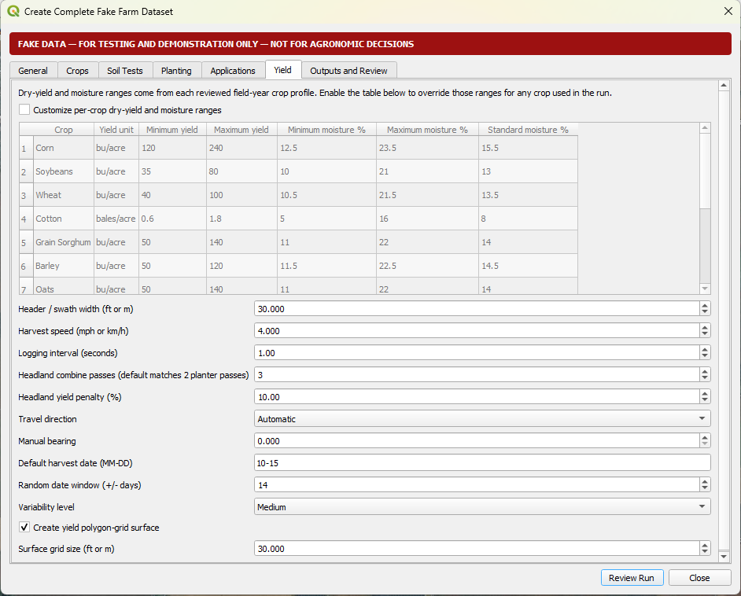
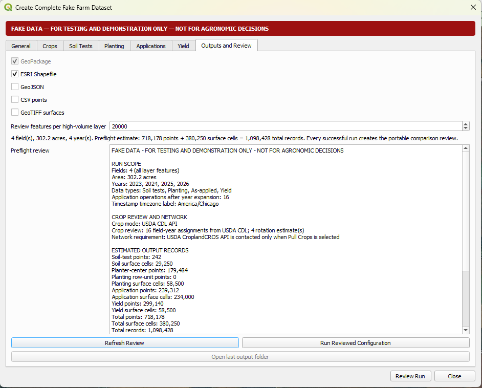
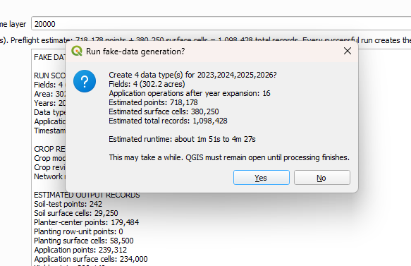
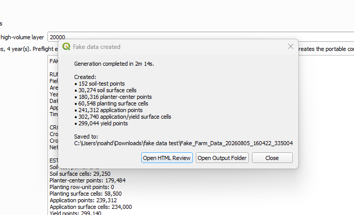

# Fake Farm Data Generator

[](https://qgis.org/)
[](https://github.com/noahdfreeman/fake-farm-data-generator/releases/latest)
[](LICENSE)

Fake Farm Data Generator is an open-source QGIS plugin for creating clearly
labeled fake precision-agriculture datasets for software development,
demonstrations, training, screenshots, and workflow testing.

> **FAKE DATA — FOR TESTING AND DEMONSTRATION ONLY — NOT FOR AGRONOMIC DECISIONS**

The plugin creates soil-test, planting, as-applied, and yield data for one or
more field polygons. Each generator is available independently in the QGIS
Processing Toolbox, and the complete seven-tab workflow can create any selected
combination in one multi-field, multi-year run.



## V1 capabilities

| Data type | Point output | Polygon-grid output |
| --- | --- | --- |
| Soil tests | Regular-grid or random samples with a configurable boundary setback | Ordinary Kriging or IDW nutrient surface |
| Planting | Planter-center points, individual row-unit points, or both | Population, speed, seed-depth, spacing, and planter-quality metrics |
| As-applied | Flat- or variable-rate machine logs for multiple operations | Actual rate, speed, and fake-terrain-effect surfaces |
| Yield | Natural-looking combine-style logs with headland passes | Dry yield, wet yield, moisture, and speed surfaces |

Additional V1 features include:

- One to 20 fields, up to 5,000 total acres, and up to 10 crop years.
- Imperial and Metric modes.
- Historical crop suggestions from the USDA CroplandCROS/CDL API, with editable
  field-year crop selections and rotation inference for unavailable years.
- A repeatable master random seed.
- GeoPackage, ESRI Shapefile, GeoJSON, point CSV, and surface GeoTIFF exports.
- Preflight record and runtime estimates, incremental progress, cancellation,
  and a detailed completion summary.
- A portable Leaflet review with field/year/type filters, selectable attributes,
  opacity, and optional split-screen comparison.
- Permanent fake-data warnings in every generated layer, manifest, recipe, and
  review page.

## Install

1. Download `fake_farm_data_generator-1.0.0.zip` from the
   [V1 release](https://github.com/noahdfreeman/fake-farm-data-generator/releases/tag/v1.0.0).
2. In QGIS, open **Plugins → Manage and Install Plugins → Install from ZIP**.
3. Select the downloaded ZIP and approve the installation.
4. Open the plugin from its toolbar icon, the **Plugins** menu, or
   **Processing Toolbox → Fake Farm Data Generator**.

QGIS 3.28 or newer is required. Windows, macOS, and Linux are supported by the
source and CI configuration; see [V1 implementation status](V1_IMPLEMENTATION_STATUS.md)
for the latest validated runtime matrix.

## Complete-run workflow

The General page selects the required output directory, one or more polygon
layers, crop years, data types, units, timezone, and seed.



The Crops page requests CDL classifications and allows every suggested crop to
be changed before generation.



<details>
<summary><strong>Soil-test settings</strong></summary>

Soil tests support grid or random placement, a 150-foot default boundary
setback, fake fertility/variability profiles, ppm or lb/acre P and K units, and
Ordinary Kriging or IDW surfaces.



</details>

<details>
<summary><strong>Planting settings</strong></summary>

Planting supports crop-specific populations and dates, planter-center or
row-unit records, advanced planter metrics, polygon-grid surfaces, and
full-perimeter headland passes.



</details>

<details>
<summary><strong>Application settings</strong></summary>

Add, duplicate, remove, and reorder flat- or variable-rate operations. An
operation can run in one selected year or every selected year.



</details>

<details>
<summary><strong>Yield settings</strong></summary>

Yield profiles vary by crop and include smooth field-scale patterns, bounded
noise, moisture, end rows, and a headland zone matched to planting.



</details>

The final page selects formats and displays estimated points, surface cells,
total records, and runtime before execution.



| Preflight confirmation | Completion summary |
| --- | --- |
|  |  |

## Example data

Two clearly labeled fake datasets are available:

- [Quick demonstration run](docs/demo/fake-farm-data-demo.zip) — a 1.9 MB
  download containing two fabricated fields and a compact sample of all four
  data types.
- [Full four-field example](https://github.com/noahdfreeman/fake-farm-data-generator/releases/download/v1.0.0/Fake_Farm_Data_Example.zip)
  — a 368 MB download containing four fields, four years, all four data types,
  GeoPackages, shapefiles, and the portable HTML review. It requires about
  8.6 GB of free space when extracted.

Both examples contain no grower identity data. Extract a ZIP and open
`fake_farm_data_review.html` in a browser. Keep the HTML file and its companion
`fake_farm_data_review_data` directory together.

## Output structure

Each complete run creates a timestamped folder containing:

```text
Fake_Farm_Data_<timestamp>/
  README_FAKE_DATA.txt
  run_manifest.json
  run_recipe.json
  fake_farm_data_review.html
  fake_farm_data_review_data/
  <year>/
    fake_farm_data_<year>.gpkg
```

GeoPackage is the canonical output. Optional formats are written as derivatives
without changing the generated fake values.

## Documentation

- [Complete V1 specification](FAKE_FARM_DATA_GENERATOR_SPECIFICATION.md)
- [Installation guide](docs/installation.md)
- [Complete-run workflow](docs/complete-run.md)
- [Parameter reference](docs/parameters.md)
- [Output schemas](docs/schemas.md)
- [Crop lookup and privacy](docs/crop-sources.md)
- [Outputs and portable review](docs/outputs-and-review.md)
- [Contributing](CONTRIBUTING.md)
- [Changelog](CHANGELOG.md)

## Development

Dependency-free tests and packaging checks:

```powershell
python -m unittest discover -s tests -p "test_*.py"
python -m compileall -q fake_farm_data_generator tests tools
python tools/package_qgis_plugin.py
python tools/validate_release_archive.py dist/fake_farm_data_generator-1.0.0.zip
```

QGIS integration tests require an installed QGIS Python runtime. GitHub Actions
workflows provide unit, packaging, QGIS compatibility, release, and Pages jobs.

## License

Copyright © Noah Freeman. Licensed under
[GPL-3.0-or-later](LICENSE).
